<div align="center">

<picture>
  <source media="(max-width: 600px)" srcset="./assets/hero-mobile.gif" />
  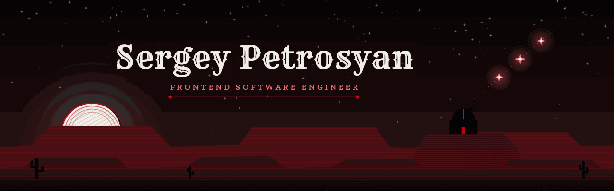
</picture>

# Sergey Petrosyan

### Frontend Software Engineer

**Building web products that stay fast, readable, and easy to change.**


<a href="https://sergeypetrosyan-as.github.io/sergeypetrosyan-as/"></a>

[About](#about) · [The Arcade](#the-arcade) · [What I Do](#what-i-do) · [Tech Stack](#tech-stack) · [Principles](#engineering-principles) · [Work](#work)

</div>

<picture>
  <source media="(prefers-color-scheme: dark)" srcset="./assets/rule-dark.png" />
  
</picture>

## About

I build production web applications with TypeScript and the React ecosystem, and I care most about the part of engineering that shows up six months later: whether the codebase is still pleasant to work in, and whether the interface still feels fast under real data.

Most of my work sits at the intersection of **architecture and interface** — designing component systems and data flows that scale past the first few screens, then making sure the result is genuinely good to use. I like complex domains, dense UIs, and problems where the naive solution stops working once real users and real datasets arrive.

I treat clarity as a feature: code that reads plainly, boundaries that are obvious, state that lives where it belongs, and abstractions introduced only once the pattern has actually repeated.

<picture>
  <source media="(prefers-color-scheme: dark)" srcset="./assets/rule-dark.png" />
  
</picture>

## The Arcade

Ten browser games, each built from scratch. Pick a card to play — every one runs in the browser, no install. The whole collection lives at **[NEON ARCADE](https://sergeypetrosyan-as.github.io/sergeypetrosyan-as/)**.

<p align="center">
<a href="https://sergeypetrosyan-as.github.io/sergeypetrosyan-as/games/unfall/">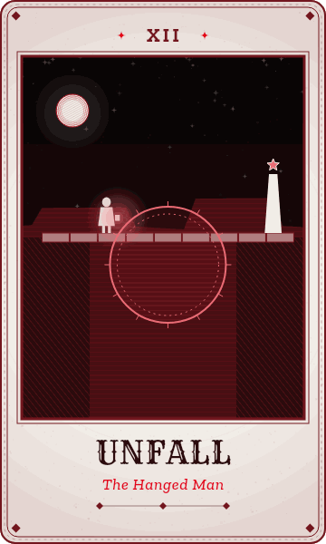</a>
<a href="https://sergeypetrosyan-as.github.io/sergeypetrosyan-as/games/neon-tanks/">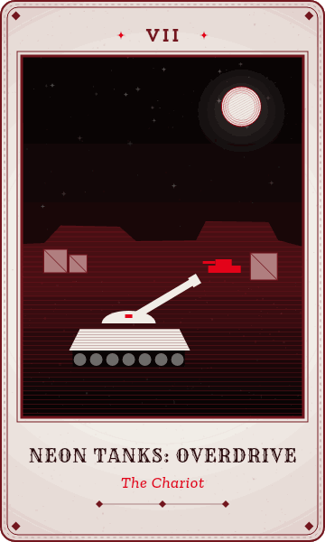</a>
<a href="https://sergeypetrosyan-as.github.io/sergeypetrosyan-as/games/neon-vice/">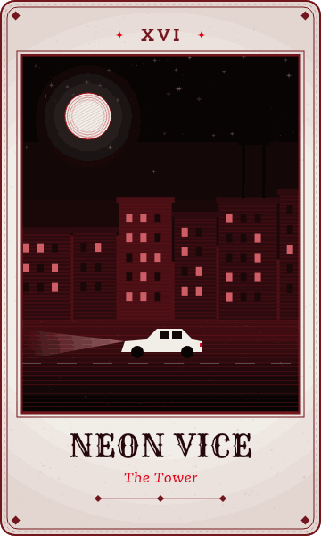</a>
<a href="https://sergeypetrosyan-as.github.io/sergeypetrosyan-as/games/neon-space-invaders/">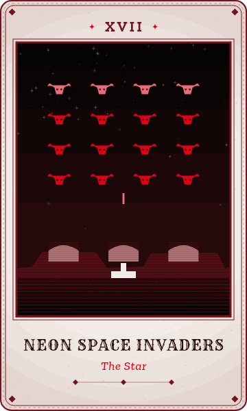</a>
<a href="https://sergeypetrosyan-as.github.io/sergeypetrosyan-as/games/neon-overdrive/">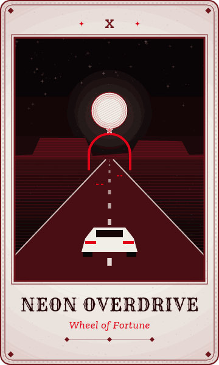</a>
<a href="https://sergeypetrosyan-as.github.io/sergeypetrosyan-as/games/paradox-room/">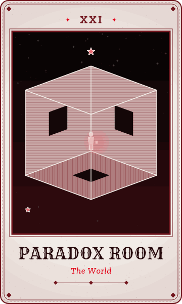</a>
<a href="https://sergeypetrosyan-as.github.io/sergeypetrosyan-as/games/ghost-signal/">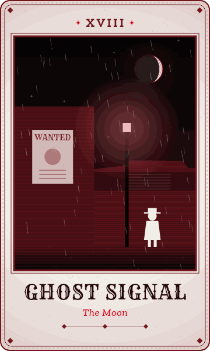</a>
<a href="https://sergeypetrosyan-as.github.io/sergeypetrosyan-as/games/blackout-protocol/">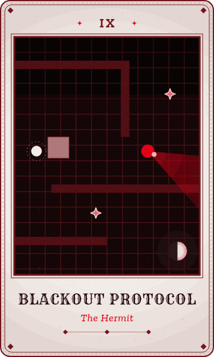</a>
<a href="https://sergeypetrosyan-as.github.io/sergeypetrosyan-as/games/void-survivor/">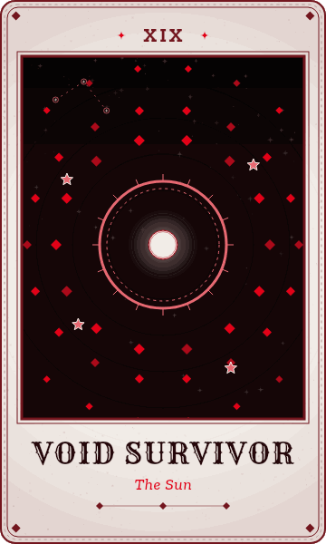</a>
<a href="https://sergeypetrosyan-as.github.io/sergeypetrosyan-as/games/neon-jump/">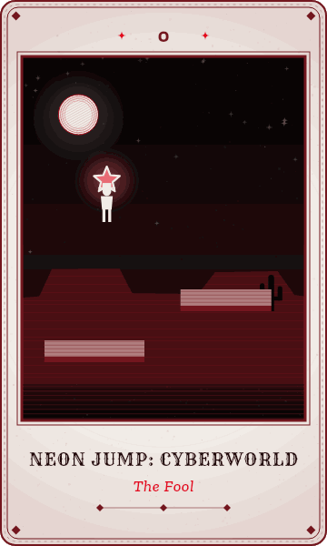</a>
</p>

### UNFALL — a time-lens game

*Vesper ends tonight. You can't steer Ilo, the courier carrying its last light — you can only hold a circle where time runs backward.*

**[Play UNFALL](https://sergeypetrosyan-as.github.io/sergeypetrosyan-as/games/unfall/)** · [Source code](./source/unfall) · TypeScript · Canvas 2D · Vite · Web Audio

<details>
<summary><b>How it plays · Controls</b></summary>
<br/>

- Inside the circle, time runs backward: slabs rise back into place, fallen signs return to their chains, presses lift, and the Hush recedes
- Outside it, time keeps going, so whatever you rebuild starts falling again on its own clock
- The circle rewinds Ilo too: catch her and she walks back through her own steps, or rescue her mid-fall
- Every second you borrow dims her lantern, and how much light reaches the lighthouse decides one of three endings
- Eight hand-built districts, a 6–10 minute night, and a soundtrack that plays backward while you hold time

| Input | Action |
|---|---|
| Mouse / finger | Aim the circle |
| Hold button / touch | Turn time back |
| Wheel · `Q` `E` | Resize the circle |
| Arrows · `Space` | Keyboard aim · hold |
| `R` · `Esc` | Restart · Pause |

</details>

### NEON TANKS: OVERDRIVE

*A true-3D arena tank shooter. Drive one way, aim the turret another, and fight bot tanks across a container port and a research facility.*

**[Play NEON TANKS](https://sergeypetrosyan-as.github.io/sergeypetrosyan-as/games/neon-tanks/)** · [Source code](./source/neon-tanks) · TypeScript · Three.js · Vite · Web Audio

<details>
<summary><b>How it plays · Controls</b></summary>
<br/>

- Two multi-level arenas, NEON DOCKS and VOID COMPLEX, with ramps, bridges, walkways, cover and see-through energy barriers
- Independent hull and turret, third-person orbit camera, real collisions, slopes and ledges
- Four weapons that play differently: PLASMA CANNON, RAIL DRIVER, VOLT EMITTER and NOVA ROCKETS
- Three hulls with their own abilities: phase dash, aegis shield and shockwave
- Team Deathmatch, Free-for-All and Control Point against bots on three difficulties (bots are always tagged BOT)
- Garage with unlocks, paints and upgrades; level, credits and career stats saved locally

| Input | Action |
|---|---|
| `W` `S` · `A` `D` | Drive · turn hull |
| Mouse · Click | Aim turret · fire |
| Wheel | Camera zoom |
| `Shift` · `Space` | Boost · ability |
| `R` · `Tab` | Reload/vent · scores |
| `Esc` · `M` | Pause · mute |

</details>

### NEON VICE — 3D Nightfall

*A 3D arcade shooter. Explore the city, take control of the streets, and survive the night.*

**[Play NEON VICE](https://sergeypetrosyan-as.github.io/sergeypetrosyan-as/games/neon-vice/)** · [Source code](./source/neon-vice) · TypeScript · Three.js · Vite · Web Audio

<details>
<summary><b>How it plays · Controls</b></summary>
<br/>

- Third-person shooting with two weapons — Neon Pistol and Pulse Rifle — headshots, reloads and combo multipliers
- Two enemy archetypes: Street Enforcers rush you, Neon Gunners keep their distance and fire telegraphed bolts
- Drivable sports cars with underglow, handbrake drifts and a speedometer
- A compact city: downtown towers, oceanfront hotels, a parking garage, backstreet alleys and a plaza
- Six escalating waves, pickups, and a local best-score board
- Original synthwave soundtrack and SFX, synthesized live with Web Audio

| Input | Action |
|---|---|
| `W` `A` `S` `D` | Move / drive |
| `Shift` · `Space` | Sprint · Jump / handbrake |
| Mouse · Left click | Aim · Fire |
| Right click | Over-the-shoulder aim |
| `R` · `1` `2` | Reload · Switch weapon |
| `E` | Enter / exit a car |
| `Esc` | Pause |

</details>

### NEON SPACE INVADERS

*A take on the arcade classic. Pilot the interceptor, dodge incoming fire and clear wave after wave before the invaders reach the grid.*

**[Play NEON SPACE INVADERS](https://sergeypetrosyan-as.github.io/sergeypetrosyan-as/games/neon-space-invaders/)** · [Source code](./games/neon-space-invaders) · JavaScript · Canvas 2D

### NEON OVERDRIVE

*Burn the reserve. Cut the Spine. An arcade racer through a megacity at midnight.*

**[Play NEON OVERDRIVE](https://sergeypetrosyan-as.github.io/sergeypetrosyan-as/games/neon-overdrive/)** · [Source code](./source/neon-overdrive) · TypeScript · Three.js · Vite · Web Audio

<details>
<summary><b>How it plays · Controls</b></summary>
<br/>

- Three laps against three AI rivals, on three tracks at three difficulties
- Drift to fill your Overdrive reserve, then spend it on boost
- The Spine is a faster inner route whose gates open only for a car with a charged reserve
- Checkpoints, lap splits and personal bests saved in your browser

| Input | Action |
|---|---|
| `W` · `S` | Accelerate · Brake |
| `A` `D` · `←` `→` | Steer |
| `Shift` · `Space` | Drift |
| `B` · `Enter` | Boost |
| `P` · `R` | Pause · Restart |

</details>

### PARADOX ROOM

*The floor is a matter of opinion. Fold small rooms a quarter-turn at a time so walls become floors.*

**[Play PARADOX ROOM](https://sergeypetrosyan-as.github.io/sergeypetrosyan-as/games/paradox-room/)** · [Source code](./source/paradox-room) · TypeScript · Three.js · Vite · Web Audio

<details>
<summary><b>How it plays · Controls</b></summary>
<br/>

- Roll or pitch a room and gravity follows: a wall becomes the floor, and you fall to it
- Nine rooms in three chapters, each one checked to be solvable, with a shortest-known solution to beat
- Hints, undo, hidden margin-note shards, and portals that remember how each room was turned

| Input | Action |
|---|---|
| `WASD` · Arrows | Move |
| `Q` · `F` | Roll the room |
| `X` · `V` | Pitch the room |
| `E` · `Space` | Interact |
| `Z` · `H` · `R` | Undo · Hint · Restart |

</details>

### GHOST SIGNAL

*Memories can lie. Timestamps can't. A detective thriller in rain-soaked Kestrel Bay.*

**[Play GHOST SIGNAL](https://sergeypetrosyan-as.github.io/sergeypetrosyan-as/games/ghost-signal/)** · [Source code](./source/ghost-signal) · TypeScript · Canvas 2D · Vite · Web Audio

<details>
<summary><b>How it plays · Controls</b></summary>
<br/>

- Rebuild a contested night from memory fragments, testimony and evidence
- Seven deduction rules check fragments against each other and expose a forged memory
- Dialogue choices are tracked, and five endings follow your conclusion

| Input | Action |
|---|---|
| Click · `Enter` | Examine / select |
| `1`–`6` | Switch tabs |
| `1`–`9` | Choose a reply |
| `Esc` · `?` | Close panel · Help |

</details>

### BLACKOUT PROTOCOL

*Cut the lights. Own the dark. Stealth and hacking across four Halcyon facilities.*

**[Play BLACKOUT PROTOCOL](https://sergeypetrosyan-as.github.io/sergeypetrosyan-as/games/blackout-protocol/)** · [Source code](./source/blackout-protocol) · TypeScript · Three.js · Vite · Web Audio

<details>
<summary><b>How it plays · Controls</b></summary>
<br/>

- Guards patrol, grow suspicious, raise the alert and search; vision cones respect walls and shadows
- A limited Energy reserve pays for every hack: loop a camera, lock a door, cut a laser grid
- Drop decoys, find keycards, crack terminal puzzles, then reach extraction unseen

| Input | Action |
|---|---|
| `WASD` · Arrows | Move |
| `Shift` | Sneak |
| `E` · `Tab` | Interact · Cycle target |
| `Space` · `F` | Hack · Drop decoy |
| `Esc` · `P` | Pause |

</details>

### VOID SURVIVOR

*Feed the void. Break the swarm. A roguelite survivor.*

**[Play VOID SURVIVOR](https://sergeypetrosyan-as.github.io/sergeypetrosyan-as/games/void-survivor/)** · [Source code](./source/void-survivor) · TypeScript · Three.js · Vite · Web Audio

<details>
<summary><b>How it plays · Controls</b></summary>
<br/>

- Kills fill your Reserve; hold it to raise a Bulwark Field, or release it as a Detonation
- Pick one of three upgrade cards on every level-up and build synergies across a 20-minute run
- Four Core Warden fights, and Shards to spend on permanent unlocks in the Vault

| Input | Action |
|---|---|
| `WASD` · Arrows | Move |
| `Q` | Hold Reserve |
| `E` · `Space` | Release (Detonation) |
| `1` `2` `3` · `4` | Pick a card · Reroll |
| `P` · `R` | Pause · Restart |

</details>

### NEON JUMP: CYBERWORLD

*A side-scrolling platformer. Run, jump and stomp across three glitching worlds to rebuild the Neon Core.*

**[Play NEON JUMP](https://sergeypetrosyan-as.github.io/sergeypetrosyan-as/games/neon-jump/)** · [Source code](./source/neon-jump) · TypeScript · Canvas 2D · Vite · Web Audio

<details>
<summary><b>How it plays · Controls</b></summary>
<br/>

- Six hand-built levels in three worlds: Neon Downtown, Cyber Factory and the Glitch Dimension
- Responsive jumps with variable height, coyote time and jump buffering
- Six original enemy types, plus lasers, crushers, rotors, live floors, timed and vanishing blocks
- Pulse Shield and Overdrive Core power-ups; neon shards, secret rooms and a hidden arcade token in every level
- A three-phase boss, the Static Sovereign, beaten by stomping its core after each slam
- Original pixel art and a synthesized soundtrack; best times, ranks and progress saved locally

| Input | Action |
|---|---|
| `A` `D` · `←` `→` | Run |
| `Space` · `W` | Jump (hold for higher) |
| `Shift` | Sprint |
| `E` | Read a terminal |
| `Esc` · `R` | Pause · Checkpoint |

</details>

<picture>
  <source media="(prefers-color-scheme: dark)" srcset="./assets/rule-dark.png" />
  
</picture>

## What I Do

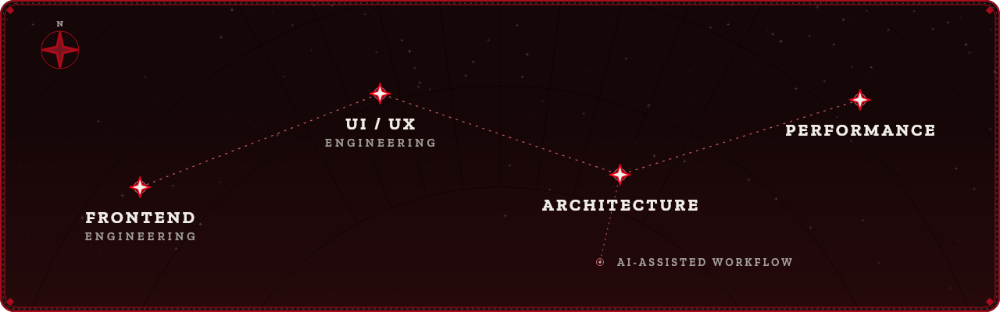

<table>
<tr>
<td width="50%" valign="top">

### Frontend Engineering

Modern React applications built in TypeScript, with a strong bias toward typed contracts at every boundary.

- Component architecture and reusable UI primitives
- Client and server state management
- Data fetching, caching, and synchronization
- Form systems with schema-driven validation
- Type-safe API integration layers

</td>
<td width="50%" valign="top">

### UI/UX Engineering

Turning product requirements and design intent into interfaces people can actually operate.

- Refining complex, information-dense screens
- Design-system thinking and visual consistency
- Responsive layouts across viewports
- Accessibility-aware markup and interaction
- Interaction and motion that serve the task

</td>
</tr>
<tr>
<td width="50%" valign="top">

### Architecture

Structuring frontends so that adding the tenth feature costs about what the second one did.

- Feature-based project organization
- Clear module and layer boundaries
- Shared component and utility layers
- Consistent API integration patterns
- Continuous refactoring toward maintainability

</td>
<td width="50%" valign="top">

### Performance

Treating responsiveness as part of the product, not a cleanup task.

- Identifying rendering and bundle bottlenecks
- Reducing unnecessary re-renders
- Optimizing large lists and heavy views
- Smooth animations and transitions
- Faster perceived load and interaction

</td>
</tr>
</table>

### AI-Assisted Development

I use AI tooling as part of a normal engineering workflow — accelerating refactors, exploration, documentation, and review — while keeping design decisions, correctness, and architectural judgment firmly human-owned. Generated code gets reviewed like any other code.

## Tech Stack

| | |
|---|---|
| **Core** |     |
| **Framework** |   |
| **State & Data** |   |
| **UI & Styling** |   |
| **Forms & Validation** |   |
| **Tooling** |    |
| **Games** |    |

## Engineering Principles

> **Optimize for the reader.** Code is written once and read constantly. Clarity beats cleverness every time.

> **Design systems, not screens.** A component that solves one screen is a feature; a component that solves a category is leverage.

> **Abstract on the third repetition.** Premature abstraction costs more than duplication, and it is much harder to undo.

> **Performance is user experience.** Latency and jank are product bugs, not engineering footnotes.

> **Make the right thing the easy thing.** Structure, types, and tooling should make correct code the path of least resistance.

> **Leave the codebase better than you found it.** Deliberate, incremental improvement beats the rewrite that never ships.

## Current Focus

```text
Frontend architecture      →  scalable structure for long-lived applications
Component systems          →  composable, typed, reusable UI foundations
Application performance    →  rendering, responsiveness, perceived speed
UI/UX engineering          →  making complex interfaces feel simple
AI-assisted workflows      →  faster iteration without losing rigor
Developer experience       →  tooling and conventions that reduce friction
```

## Work

Currently working as a **Software Engineer** in a professional product development environment, building and maintaining production web applications.

Day to day, that means developing features end to end, integrating frontend systems with backend APIs, refactoring and improving existing interfaces, maintaining frontend architecture as products grow, improving performance and usability, and collaborating closely with engineering, design, and product colleagues.

<div align="center">

<sub>Open to conversations about frontend architecture, UI engineering, and building better products.</sub>

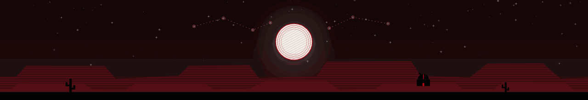

</div>
