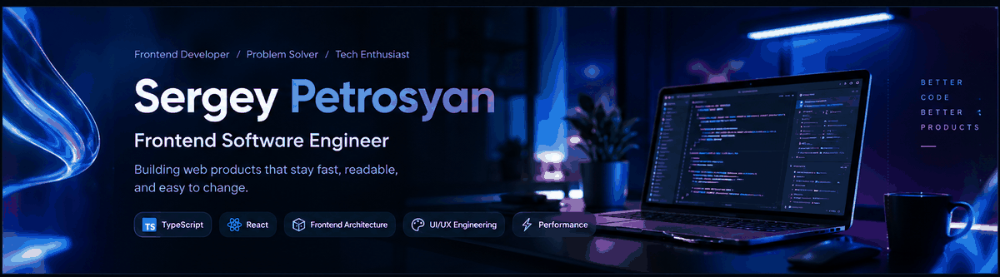
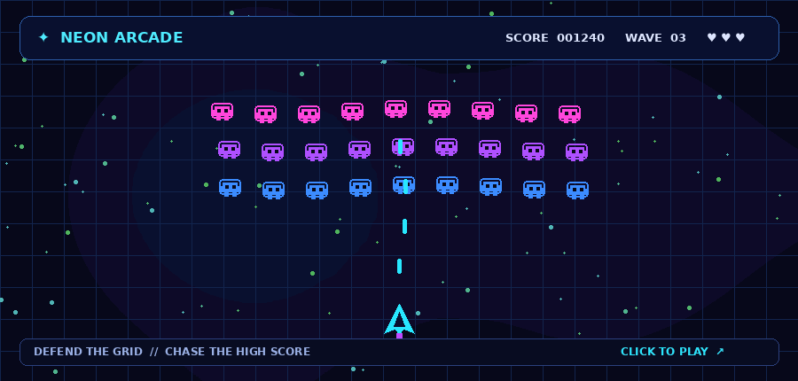

<div align="center">



</div>

<div align="center">

# Sergey Petrosyan

### Frontend Software Engineer

**Building web products that stay fast, readable, and easy to change.**

<br/>


<br/>

<a href="https://sergeypetrosyan-as.github.io/sergeypetrosyan-as/"></a>

</div>

<br/>

---

## About

I build production web applications with TypeScript and the React ecosystem, and I care most about the part of engineering that shows up six months later: whether the codebase is still pleasant to work in, and whether the interface still feels fast under real data.

Most of my work sits at the intersection of **architecture and interface** — designing component systems and data flows that scale past the first few screens, then making sure the result is genuinely good to use. I like complex domains, dense UIs, and problems where the naive solution stops working once real users and real datasets arrive.

I treat clarity as a feature: code that reads plainly, boundaries that are obvious, state that lives where it belongs, and abstractions introduced only once the pattern has actually repeated.

<br/>

<div align="center">

## 🎮 Neon Space Invaders

<a href="https://sergeypetrosyan-as.github.io/sergeypetrosyan-as/game/">
  
</a>

**[▶ PLAY THE GAME](https://sergeypetrosyan-as.github.io/sergeypetrosyan-as/game/)**

</div>

<br/>

<div align="center">

## 🌆 NEON VICE — 3D NIGHTFALL

<a href="https://sergeypetrosyan-as.github.io/sergeypetrosyan-as/neon-vice/">
  
</a>

*A neon-soaked 3D arcade shooter. Explore the city, take control of the streets, and survive the night.*

**[▶ PLAY THE GAME](https://sergeypetrosyan-as.github.io/sergeypetrosyan-as/neon-vice/)** &nbsp;·&nbsp; [Source code](./games/neon-vice-city)


</div>

<table>
<tr>
<td width="55%" valign="top">

**Features**

- Third-person shooting with two weapons — Neon Pistol and Pulse Rifle — headshots, reloads and combo multipliers
- Two enemy archetypes: Street Enforcers rush you, Neon Gunners keep their distance and fire telegraphed bolts
- Drivable neon sports cars with underglow, handbrake drifts and a speedometer
- A compact city: downtown towers, oceanfront hotels, a parking garage, backstreet alleys and a plaza
- Six escalating waves, pickups, and a local best-score board
- Original synthwave soundtrack and SFX, synthesized live with Web Audio

</td>
<td width="45%" valign="top">

**Desktop controls**

| | |
|---|---|
| `W` `A` `S` `D` | Move / drive |
| `Shift` · `Space` | Sprint · Jump / handbrake |
| Mouse · Left click | Aim · Fire |
| Right click | Over-the-shoulder aim |
| `R` · `1` `2` | Reload · Switch weapon |
| `E` | Enter / exit a car |
| `Esc` | Pause |

</td>
</tr>
</table>

<br/>

## What I Do

<table>
<tr>
<td width="50%" valign="top">

### Frontend Engineering

Modern React applications built in TypeScript, with a strong bias toward typed contracts at every boundary.

- Component architecture and reusable UI primitives
- Client and server state management
- Data fetching, caching, and synchronization
- Form systems with schema-driven validation
- Type-safe API integration layers

</td>
<td width="50%" valign="top">

### UI/UX Engineering

Turning product requirements and design intent into interfaces people can actually operate.

- Refining complex, information-dense screens
- Design-system thinking and visual consistency
- Responsive layouts across viewports
- Accessibility-aware markup and interaction
- Interaction and motion that serve the task

</td>
</tr>
<tr>
<td width="50%" valign="top">

### Architecture

Structuring frontends so that adding the tenth feature costs about what the second one did.

- Feature-based project organization
- Clear module and layer boundaries
- Shared component and utility layers
- Consistent API integration patterns
- Continuous refactoring toward maintainability

</td>
<td width="50%" valign="top">

### Performance

Treating responsiveness as part of the product, not a cleanup task.

- Identifying rendering and bundle bottlenecks
- Reducing unnecessary re-renders
- Optimizing large lists and heavy views
- Smooth animations and transitions
- Faster perceived load and interaction

</td>
</tr>
</table>

### AI-Assisted Development

I use AI tooling as part of a normal engineering workflow — accelerating refactors, exploration, documentation, and review — while keeping design decisions, correctness, and architectural judgment firmly human-owned. Generated code gets reviewed like any other code.

<br/>

## Tech Stack

<table>
<tr>
<td valign="middle"><b>Core</b></td>
<td>


</td>
</tr>
<tr>
<td valign="middle"><b>Framework</b></td>
<td>


</td>
</tr>
<tr>
<td valign="middle"><b>State &amp; Data</b></td>
<td>


</td>
</tr>
<tr>
<td valign="middle"><b>UI &amp; Styling</b></td>
<td>


</td>
</tr>
<tr>
<td valign="middle"><b>Forms &amp; Validation</b></td>
<td>


</td>
</tr>
<tr>
<td valign="middle"><b>Tooling</b></td>
<td>


</td>
</tr>
</table>

<br/>

## Engineering Principles

> **Optimize for the reader.** Code is written once and read constantly. Clarity beats cleverness every time.

> **Design systems, not screens.** A component that solves one screen is a feature; a component that solves a category is leverage.

> **Abstract on the third repetition.** Premature abstraction costs more than duplication, and it is much harder to undo.

> **Performance is user experience.** Latency and jank are product bugs, not engineering footnotes.

> **Make the right thing the easy thing.** Structure, types, and tooling should make correct code the path of least resistance.

> **Leave the codebase better than you found it.** Deliberate, incremental improvement beats the rewrite that never ships.

<br/>

## Current Focus

```text
Frontend architecture      →  scalable structure for long-lived applications
Component systems          →  composable, typed, reusable UI foundations
Application performance    →  rendering, responsiveness, perceived speed
UI/UX engineering          →  making complex interfaces feel simple
AI-assisted workflows      →  faster iteration without losing rigor
Developer experience       →  tooling and conventions that reduce friction
```

<br/>

## Work

Currently working as a **Software Engineer** in a professional product development environment, building and maintaining production web applications.

Day to day, that means developing features end to end, integrating frontend systems with backend APIs, refactoring and improving existing interfaces, maintaining frontend architecture as products grow, improving performance and usability, and collaborating closely with engineering, design, and product colleagues.

<br/>

<sub>Open to conversations about frontend architecture, UI engineering, and building better products.</sub>

</div>

<div align="center">
  
</div>
