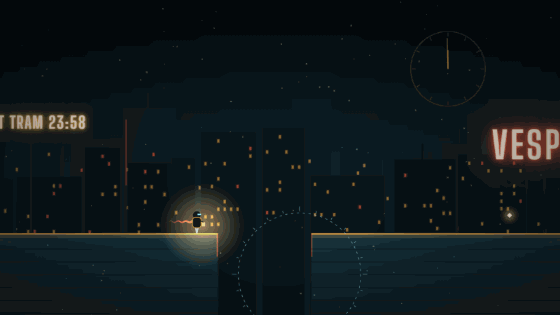

# UNFALL

**A time-lens game.** The city of Vesper ends tonight. Ilo, a small courier robot, is carrying its last light to the lighthouse. You can't steer her. You can only hold a circle where time runs backward.

**Play:** https://sergeypetrosyan-as.github.io/sergeypetrosyan-as/games/unfall/



*Real gameplay: Ilo waits at a broken bridge, a too-shallow rewind lets it fall under her, the circle catches her mid-fall and everything un-falls, then she crosses.*

## How it plays

- Inside the circle, everything runs **backward**: broken slabs rise and lock back into place, fallen signs return to their chains, presses lift, lifts reverse, and the Hush recedes.
- **Outside the circle, time keeps going.** Whatever you rebuilt starts falling again on its own clock, so rewind far enough to buy the seconds she needs.
- **The circle rewinds Ilo too.** Catch her and she walks backward through her own steps, which is a mistake when you wanted her to cross. It's a rescue when she's falling or has just come apart: nothing is final while the circle is on it.
- Some things are better left to fall. A sign that lands across a gap is a bridge.
- Using the circle spends the district's **spare time**, and bigger circles cost more. Sparks (lost seconds) give some back.
- Every borrowed second **dims Ilo's lantern**. Whatever light reaches the lighthouse decides how much of Vesper is remembered. There are three endings.

### Controls

| | |
|---|---|
| Mouse / finger | Aim the circle |
| Hold button / touch | Turn time back inside it |
| Wheel, `Q` / `E`, `1`–`3` | Small / medium / large circle |
| Arrows + `Space` | Keyboard-only aiming and holding |
| `Esc` / `P` | Pause |
| `R` | Restart the district |
| `Enter` | Skip the district card / continue |

There's no pointer lock and no right-click, so it works with a mouse, a trackpad or touch.

## Structure

Eight hand-built districts, about 6–10 minutes for a first night:

1. **The Last Tram**: one broken bridge; learn to rewind far enough.
2. **Signs of Leaving**: lift one sign without catching Ilo; let another fall into a bridge.
3. **Glass Bridge**: panes give way behind her; rebuild missing ones ahead, keeping the circle off her.
4. **The Hush**: an erasing wall of static advances; push it back while repairing the road.
5. **Clockwork Market**: presses on a cycle and a lift; rewinding reverses both.
6. **Freefall**: a floor that won't hold if she stops; catch her mid-fall; a collapse wave ahead.
7. **The Last Bridge**: the reversal. The billboards explain where the borrowed seconds come from.
8. **The Lighthouse**: the finale. The circle swells over the whole city and everything un-falls.

District results (seconds borrowed, best per district, best ending) are saved in `localStorage`. Replaying any district to borrow less changes the ending.

## How it's built

- **No physics history for the world.** Every object owns a clock τ, and its pose and solidity are a pure function of τ (`src/sim/objects.ts`). The lens only flips the sign of dτ (1.6× backward), so rewinding is exact and costs nothing. The lens reaches an object at its current position *or* its home position, which is how slabs that fell off-screen can be rebuilt by aiming at the gap.
- **Ilo is the exception.** She is driven by simple rules (walk; wait at gaps and walls; fall) and records 15 s of her own history, which the lens plays back. That's also how a death is undone (`src/sim/Courier.ts`).
- **Rendering** is Canvas 2D (`src/render/Renderer.ts`): parallax skylines generated from a seed, neon text baked once per district, the lens as a `difference`-composited disc (a photographic negative of the present), and the Hush as animated static. The ash particles have their own clocks, so they rise inside the lens.
- **Audio** is all Web Audio (`src/audio/Audio.ts`). The score is synthesized once with an `OfflineAudioContext`, and holding the lens switches to a reversed copy at the mirrored position, so the music runs backward from the moment you grab time. There's a tape-rewind noise bed, a Hush hiss that grows as it approaches, and panned SFX. Nothing plays before the first click or key.
- Fixed 60 Hz simulation steps, render once per frame, and no allocations in the hot loop.

```
src/
├── main.ts              # boot, font wait, fallback message
├── game/                # Game (loop, flow, endings), Input, Save
├── sim/                 # World, Courier, timed objects, types
├── levels/levels.ts     # the eight districts as data
├── render/Renderer.ts
├── audio/Audio.ts
├── ui/Ui.ts             # DOM screens and HUD
└── styles.css
```

Design notes, including the five concepts considered and how they scored, are in [DESIGN.md](./DESIGN.md).

## Develop and deploy

```bash
cd source/unfall
npm install
npm run dev        # http://localhost:5220 (dev builds expose window.__unfall for scripted play-testing)
npm run build      # type-check, then write the static game to ../../games/unfall/
```

GitHub Pages serves this repository from `main` / root, so the committed `games/unfall/` folder is the deployment, like every game. The game is registered in the NEON ARCADE hub at `site/src/data/games.ts`. Rebuild the hub (`cd site && npm run build`) after changing its card.

## Known limitations

- The ending tally counts your most recent result in each district. If you jump in from the district list without playing the others, those count as zero borrowed.
- Phones work (touch to hold), but the circle sits under your finger, so it's drawn 40 px above the touch point. A mouse is more precise.
- The README GIF shows the canvas only. The HUD is HTML layered on top.
